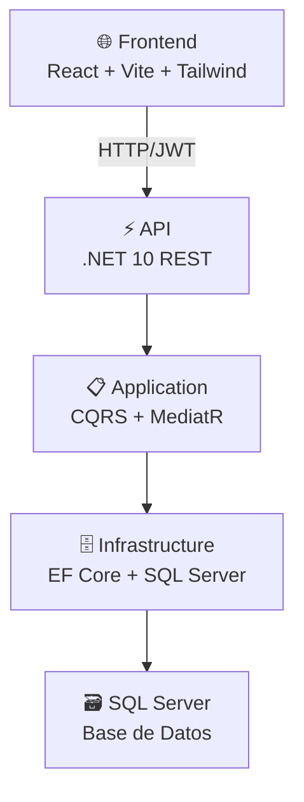

<div align="center">

# ✈️ AeroManager — Terminal OPS Suite

**Plataforma Centralizada de Gestión Aeroportuaria**

[](https://dotnet.microsoft.com/)
[](https://react.dev/)
[](https://www.typescriptlang.org/)
[](https://vitejs.dev/)
[](https://tailwindcss.com/)
[](https://www.microsoft.com/sql-server)
[](https://www.docker.com/)

> Sistema integral para administración de infraestructura aeroportuaria, flota aérea, programación de vuelos, asignación de puertas de embarque y emisión de reservas en mostrador.

</div>

---

## 📸 Capturas de Pantalla

### 🔐 Pantalla de Login — Video Background + Glassmorphism


> *Pantalla de acceso con video de fondo animado, overlay degradado y tarjeta glassmorphism con animación slide-up.*

---

## 🏗️ Arquitectura del Proyecto

```
AeroManager_Proyect/
│
├── 📦 Aeromanager.Domain/           # Entidades, interfaces, enumeraciones
├── 📦 Aeromanager.Application/      # Casos de uso (CQRS), DTOs, Validators
├── 📦 Aeromanager.Infrastructure/   # EF Core, repositorios, JWT, servicios externos
├── 📦 Aeromanager.Api/              # Controllers REST, middlewares, Program.cs
└── 🌐 Aeromanager.Frontend/         # React + Vite + Tailwind (SPA)
```



---

## 🧩 Módulos por Perfil Operativo

### 👑 SuperAdmin
| Módulo | Descripción |
|--------|-------------|
| Dashboard Global | Métricas y KPIs de todo el sistema |
| Gestión de Usuarios | CRUD completo de usuarios del sistema |
| Roles y Permisos | Asignación de roles a usuarios |

### 🛠️ Administrador
| Módulo | Descripción |
|--------|-------------|
| **Dashboard Ejecutivo** | Métricas operativas, reportes resumidos |
| **Catálogos → Países** | Gestión de países |
| **Catálogos → Ciudades** | Gestión de ciudades por país |
| **Catálogos → Tipos de Documento** | DNI, Pasaporte, CE, etc. |
| **Flota → Aerolíneas** | Registro y gestión de aerolíneas |
| **Flota → Modelos de Avión** | Boeing, Airbus, Embraer, etc. |
| **Flota → Aviones** | Registro de aeronaves por aerolínea |
| **Flota → Clases de Asiento** | Económica, Business, Primera Clase |
| **Flota → Asientos** | Mapa de asientos por modelo de avión |
| **Infraestructura → Aeropuertos** | Registro de aeropuertos por ciudad |
| **Infraestructura → Terminales** | Terminales dentro del aeropuerto |
| **Infraestructura → Puertas de Embarque** | Gates por terminal |
| **Operaciones → Reportes Excel** | Exportación de datos operativos |
| **Seguridad → Usuarios** | Gestión de accesos |
| **Seguridad → Roles y Permisos** | Configuración de roles |

### 🛩️ Operador de Vuelos
| Módulo | Descripción |
|--------|-------------|
| **Monitor FIDS** | Flight Information Display System en tiempo real |
| **Monitor de Gates** | Estado de puertas de embarque |
| **Programación de Vuelos** | Creación y edición de vuelos |
| **Rutas** | Gestión de rutas origen-destino |
| **Flota Operativa** | Estado de aeronaves en operación |
| **Disponibilidad de Cabina** | Capacidad disponible por vuelo |

### 🎫 Agente de Counter
| Módulo | Descripción |
|--------|-------------|
| **Cartelera de Vuelos** | Vuelos disponibles para reservas |
| **Mapa de Cabina & Reservas** | Selección de asiento + reserva en tiempo real |
| **Padrón de Pasajeros** | Registro y búsqueda de pasajeros |
| **Historial de Tickets** | Consulta de tickets emitidos |

---

## 🛠️ Stack Tecnológico

### Backend
| Tecnología | Versión | Uso |
|-----------|---------|-----|
| **.NET** | 10.0 | Framework principal |
| **ASP.NET Core** | 10.0 | API REST |
| **Entity Framework Core** | 10.x | ORM + Migrations |
| **MediatR** | — | CQRS (Commands/Queries) |
| **FluentValidation** | 12.x | Validación de DTOs |
| **JWT Bearer** | — | Autenticación sin estado |
| **BCrypt** | — | Hash de contraseñas |
| **ClosedXML** | — | Generación de reportes Excel |
| **Gemini AI** | — | Asistente IA integrado |
| **SQL Server** | 2022 | Base de datos relacional |
| **Docker** | — | Contenerización |

### Frontend
| Tecnología | Versión | Uso |
|-----------|---------|-----|
| **React** | 18 | UI framework |
| **TypeScript** | 5 | Tipado estático |
| **Vite** | 6 | Build tool / Dev server |
| **Tailwind CSS** | 3 | Utility-first styling |
| **React Router** | 6 | Enrutamiento SPA |
| **Axios** | — | Cliente HTTP |
| **Material Symbols** | — | Iconografía |

---

## ⚙️ Instalación y Configuración

### Prerequisitos

- [.NET 10 SDK](https://dotnet.microsoft.com/download/dotnet/10.0)
- [Node.js 20+](https://nodejs.org/)
- [SQL Server 2022](https://www.microsoft.com/sql-server) o superior
- [Git](https://git-scm.com/)

### 1️⃣ Clonar el repositorio

```bash
git clone https://github.com/Josue123212/AeroManager_Proyect.git
cd AeroManager_Proyect
```

### 2️⃣ Configurar la Base de Datos

Editar `Aeromanager.Api/appsettings.json`:

```json
{
  "ConnectionStrings": {
    "DefaultConnection": "Server=TU_SERVIDOR;Database=AeroManagerDB;User Id=TU_USUARIO;Password=TU_PASSWORD;TrustServerCertificate=True;"
  },
  "JwtSettings": {
    "SecretKey": "TU_CLAVE_SECRETA_MIN_32_CARACTERES",
    "Issuer": "AeroManager",
    "Audience": "AeroManagerUsers",
    "ExpirationMinutes": 480
  }
}
```

### 3️⃣ Aplicar Migraciones

```bash
cd Aeromanager.Api
dotnet ef database update
```

### 4️⃣ Levantar el Backend

```bash
dotnet run --project Aeromanager.Api
# API disponible en: https://localhost:7001
# Swagger UI en:    https://localhost:7001/swagger
```

### 5️⃣ Levantar el Frontend

```bash
cd Aeromanager.Frontend
npm install
npm run dev
# App disponible en: http://localhost:5173
```

---

## 🐳 Docker

```bash
# Build de la imagen
docker build -t aeromanager .

# Correr el contenedor
docker run -p 8080:8080 aeromanager
```

---

## 🔐 Autenticación

AeroManager usa **JWT Bearer Tokens** con control de roles.

```
POST /api/auth/login
Body: { "email": "...", "password": "..." }
Response: { "token": "eyJ...", "roles": [...], "nombreCompleto": "..." }
```

El token se almacena en `localStorage` y se envía en cada request como:
```
Authorization: Bearer <token>
```

### Roles disponibles
| Rol | Código | Acceso |
|-----|--------|--------|
| SuperAdmin | `SuperAdmin` | Todo el sistema |
| Administrador | `Administrador` | Catálogos, Flota, Infraestructura, Reportes |
| Operador de Vuelos | `Operador` | FIDS, Gates, Programación, Rutas |
| Agente de Counter | `Counter` | Reservas, Cabina, Pasajeros, Tickets |

---

## 📁 Estructura del Frontend

```
Aeromanager.Frontend/src/
├── api/                    # axiosClient + interceptores JWT
├── components/
│   ├── auth/               # ProtectedRoute, guards por rol
│   ├── layout/             # Sidebar, Navbar, Shell
│   └── ui/                 # Componentes reutilizables
├── pages/
│   ├── auth/               # LoginPage
│   ├── admin/              # Dashboard + Catálogos + Flota + Infraestructura
│   ├── operador/           # FIDS + Gates + Programación + Rutas
│   ├── counter/            # Reservas + Cabina + Pasajeros + Tickets
│   └── superadmin/         # Dashboard + Usuarios + Roles
├── types/                  # Interfaces TypeScript (models.ts)
└── utils/                  # Helpers y formateadores
```

---

## 🌐 Endpoints API Principales

| Método | Endpoint | Descripción |
|--------|----------|-------------|
| `POST` | `/api/auth/login` | Autenticación JWT |
| `GET` | `/api/vuelos` | Listar vuelos |
| `POST` | `/api/vuelos` | Crear vuelo |
| `GET` | `/api/reservas` | Listar reservas |
| `POST` | `/api/reservas` | Crear reserva |
| `GET` | `/api/asientosvuelo/{vueloId}` | Mapa de cabina |
| `GET` | `/api/reportes/excel` | Exportar Excel |
| `POST` | `/api/ai/assistant` | Consulta al asistente IA |
| `GET` | `/api/usuarios` | Gestión de usuarios |
| `GET` | `/api/aeropuertos` | Catálogo de aeropuertos |

> 📖 Documentación completa disponible en Swagger: `https://localhost:7001/swagger`

---

## 👥 Equipo de Desarrollo

| Nombre | Rol | GitHub |
|--------|-----|--------|
| **Josue Jonas** | Líder / Backend | [@Josue123212](https://github.com/Josue123212) |
| **Dixson Apaza** | Backend / Fronted | `dixsonapaza-ui` |
| **Julio** | Backend / Infrastructure | — |
| **Alexander Tito** | Backend / Infrastructure | — |

> Proyecto desarrollado como parte del programa **TECSUP** — 2026.

---

## 📄 Licencia

Este proyecto es de uso **académico**. Todos los derechos reservados © 2026 — Equipo AeroManager TECSUP.

---

<div align="center">

**AeroManager OPS Suite** · Acceso Restringido · v2.0

*Built with ❤️ at TECSUP*

</div>
