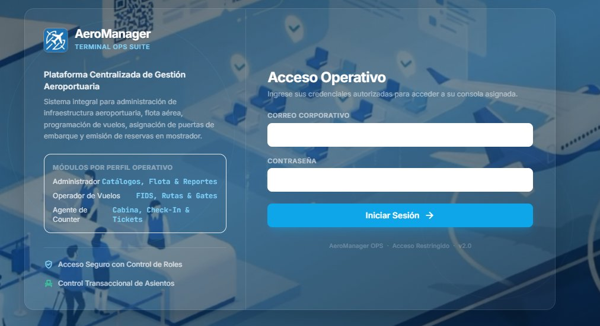
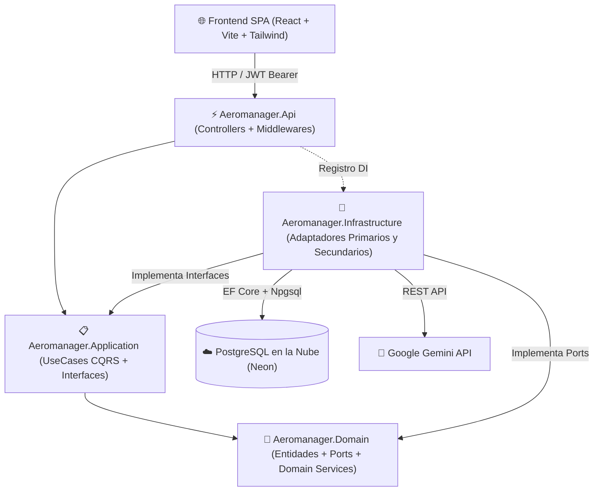

<div align="center">

# ✈️ AeroManager — Terminal OPS Suite

**Plataforma Centralizada de Gestión Aeroportuaria**

[](https://dotnet.microsoft.com/)
[](https://react.dev/)
[](https://www.typescriptlang.org/)
[](https://vitejs.dev/)
[](https://tailwindcss.com/)
[](https://neon.tech/)
[](https://ai.google.dev/)
[](https://www.docker.com/)

> Sistema integral para administración de infraestructura aeroportuaria, flota aérea, programación de vuelos, asignación de puertas de embarque, emisión transaccional de reservas en mostrador, reportes ejecutivos `.xlsx` y asistencia operativa con IA.

</div>

---

## 📸 Capturas de Pantalla

### 🔐 Pantalla de Login — Video Background + Glassmorphism



> *Pantalla de acceso con video de fondo animado, overlay degradado y tarjeta glassmorphism con animación slide-up.*

---

## 🏗️ Arquitectura Hexagonal (Puertos y Adaptadores)

El backend implementa **Arquitectura Hexagonal (Clean Architecture + Ports & Adapters)** asegurando que el núcleo del negocio (`Aeromanager.Domain`) tenga **cero dependencias de librerías o frameworks externos**.

```text
AeroManager_Proyect/
│
├── 📦 Aeromanager.Domain/           # Núcleo puro (0 paquetes NuGet): 20 Entidades, Ports (Repositorios/UoW) y Domain Services
├── 📦 Aeromanager.Application/      # Orquestación CQRS (Commands/Queries), DTOs, FluentValidation e Interfaces externas
├── 📦 Aeromanager.Infrastructure/   # Adaptadores Primarios (EF Core + Npgsql, GenericRepository, UnitOfWork) y Secundarios (JWT, SHA-256, Excel .xlsx, Gemini IA)
├── 📦 Aeromanager.Api/              # 23 Controllers REST, Middlewares (Logging, Exceptions, JWT Auth), Swagger/OpenAPI y Program.cs
└── 🌐 Aeromanager.Frontend/         # React 18 + TypeScript + Vite + Tailwind CSS (SPA Multi-Rol)
```



---

## 🧩 Módulos por Perfil Operativo

### 👑 SuperAdmin
| Módulo | Descripción |
|--------|-------------|
| **Command Center Global** | Métricas en vivo, salud de API y conmutación de consolas operativas |
| **Gestión de Usuarios** | CRUD completo, activación/desactivación y cambio seguro de contraseña |
| **Roles y Permisos (RBAC)** | Asignación de rol único activo, cambio de rol y revocación inmediata |

### 🛠️ Administrador
| Módulo | Descripción |
|--------|-------------|
| **Dashboard Ejecutivo** | KPIs operativos y gráficos analíticos (circular, barras y área) |
| **Catálogos → Países / Ciudades** | Gestión geográfica con activación y desactivación lógica |
| **Catálogos → Tipos de Documento** | DNI, Pasaporte, Carné de Extranjería, etc. |
| **Flota → Aerolíneas & Modelos** | Registro de aerolíneas y modelos Boeing, Airbus, Embraer, etc. |
| **Flota → Aviones & Cabina** | Aeronaves por aerolínea, clases de asiento y mapa de asientos |
| **Infraestructura Aeroportuaria** | Aeropuertos, terminales y puertas de embarque (Gates) |
| **Operaciones → Reportes `.xlsx`** | Exportación nativa en Excel de Vuelos, Reservas y Pasajeros |
| **Copilot Operativo IA** | Burbuja flotante arrastrable conectada a Google Gemini con contexto en vivo |

### 🛩️ Operador de Vuelos
| Módulo | Descripción |
|--------|-------------|
| **Monitor FIDS** | Flight Information Display System con sincronización automática cada 30s |
| **Monitor de Gates** | Control de ocupación y buffer operativo de 45 min en puertas de embarque |
| **Programación de Vuelos** | Creación, estados operativos y reglas de bloqueo para vuelos cerrados |
| **Rutas & Flota Operativa** | Gestión de rutas origen-destino y disponibilidad de cabina por vuelo |

### 🎫 Agente de Counter
| Módulo | Descripción |
|--------|-------------|
| **Cartelera de Vuelos** | Vuelos abiertos para venta con cierre automático en abordaje/vuelo |
| **Mapa de Cabina & Reservas** | Selección visual de asiento y reserva transaccional (`UnitOfWork`) |
| **Padrón de Pasajeros** | Registro, búsqueda y estado de pasajeros |
| **Pase de Abordaje QR & Tickets** | Emisión de boarding pass con código QR real e impresión limpia a PDF |

---

## 🛠️ Stack Tecnológico

### Backend
| Tecnología | Versión | Uso en el Proyecto |
|-----------|---------|--------------------|
| **.NET / ASP.NET Core** | 10.0 | Web API REST y contenedor de inyección de dependencias |
| **Entity Framework Core** | 10.0.14 | ORM, Fluent API, `GenericRepository` y `UnitOfWork` transaccional |
| **Npgsql EF Core** | 10.0.3 | Proveedor oficial para **PostgreSQL** |
| **PostgreSQL (Neon Cloud)** | 16 / 17 | Base de datos relacional serverless desplegada en la nube |
| **CQRS Nativo** | — | Separación limpia en `Commands` y `Queries` por caso de uso |
| **FluentValidation** | 12.2.0 | Validación declarativa de comandos de entrada |
| **NSwag / OpenAPI** | 14.7.1 | Documentación interactiva Swagger UI (`/swagger`) |
| **JWT HMAC-SHA256** | Nativo | `JwtTokenService` + `BearerAuthenticationHandler` personalizado |
| **SHA-256** | Nativo | `PasswordHasher` para almacenamiento seguro de credenciales |
| **OpenXML (`.xlsx`)** | Nativo | `ExcelReportService` con estilos corporativos sin librerías externas |
| **Google Gemini API** | REST | `GeminiAiService` como adaptador secundario de inteligencia artificial |
| **Docker** | Multi-stage | Imagen de producción `.NET 10.0` lista para despliegue en Render |

### Frontend
| Tecnología | Versión | Uso en el Proyecto |
|-----------|---------|--------------------|
| **React** | 18.3 | Biblioteca principal de interfaz de usuario |
| **TypeScript** | 5.6 | Tipado estático de modelos y contratos API |
| **Vite** | 6.0 | Empaquetador y servidor de desarrollo |
| **Tailwind CSS** | 3.4 | Diseño responsivo y tema corporativo |
| **React Router** | 7.1 | Enrutamiento SPA con guardias `ProtectedRoute` por rol |
| **Axios** | 1.7 | Cliente HTTP con interceptores automáticos de token JWT |
| **qrcode.react** | 4.2 | Generación de códigos QR reales en pases de abordaje |
| **Lucide React & Material Symbols** | — | Iconografía aeronáutica e interfaz operativa |

---

## ⚙️ Instalación y Configuración Local

### Prerrequisitos

- [.NET 10 SDK](https://dotnet.microsoft.com/download/dotnet/10.0)
- [Node.js 20+](https://nodejs.org/)
- Instancia de **PostgreSQL** (local o en la nube con [Neon](https://neon.tech/))
- [Git](https://git-scm.com/)

### 1️⃣ Clonar el repositorio

```bash
git clone https://github.com/Josue123212/AeroManager_Proyect.git
cd AeroManager_Proyect
```

### 2️⃣ Configurar variables en `Aeromanager.Api/appsettings.json`

```json
{
  "ConnectionStrings": {
    "DefaultConnection": "Host=TU_HOST_NEON_O_LOCAL;Database=neondb;Username=TU_USUARIO;Password=TU_PASSWORD;SSL Mode=Require;Trust Server Certificate=true"
  },
  "JwtSettings": {
    "SecretKey": "TU_CLAVE_SECRETA_SEGURA"
  },
  "GeminiSettings": {
    "ApiKey": "TU_API_KEY_DE_GOOGLE_GEMINI"
  }
}
```

### 3️⃣ Levantar el Backend (.NET 10 Web API)

```bash
dotnet run --project Aeromanager.Api
# Swagger UI disponible en la raíz (/ redirige automáticamente a /swagger)
```

### 4️⃣ Levantar el Frontend (React + Vite)

```bash
cd Aeromanager.Frontend
npm install
npm run dev
# App disponible en: http://localhost:5173
```

---

## 🐳 Despliegue con Docker

```bash
# Construir imagen multi-stage (.NET 10 SDK -> ASP.NET Runtime)
docker build -t aeromanager-api .

# Ejecutar contenedor en puerto 8080
docker run -p 8080:8080 aeromanager-api
```

---

## 🔐 Autenticación y Seguridad

AeroManager protege sus endpoints mediante **JWT Bearer Tokens**, validación de expiración en cliente/servidor y middlewares dedicados (`RequestLoggingMiddleware`, `ExceptionHandlingMiddleware` y `BearerAuthenticationHandler`).

```http
POST /api/auth/login
Content-Type: application/json

{ "email": "usuario@aeromanager.com", "password": "..." }
```

### Roles del Sistema
| Rol | Código | Alcance Principal |
|-----|--------|-------------------|
| SuperAdmin | `SuperAdmin` | Control total, usuarios, RBAC y supervisión multi-consola |
| Administrador | `Administrador` | Dashboard ejecutivo, catálogos, flota, sedes y reportes `.xlsx` |
| Operador de Vuelos | `Operador` | Monitor FIDS, gates, programación de vuelos y rutas |
| Agente de Counter | `Counter` | Venta de boletos, mapa de asientos, pasajeros y pases QR |

---

## 🌐 Endpoints API Principales (23 Controladores REST)

| Método | Endpoint | Descripción |
|--------|----------|-------------|
| `POST` | `/api/auth/login` | Autenticación y emisión de JWT con roles activos |
| `GET` / `POST` / `PUT` | `/api/vuelos` | Gestión y programación operativa de vuelos |
| `GET` / `POST` | `/api/reservas` | Gestión de cabeceras de reserva (PNR) |
| `POST` | `/api/detallesreserva` | Asignación atómica de asiento + pasajero (`UnitOfWork`) |
| `GET` | `/api/asientosvuelo` | Consulta de inventario y ocupación de cabina |
| `GET` | `/api/reportes/vuelos-excel` | Descarga de reporte ejecutivo de vuelos (`.xlsx`) |
| `GET` | `/api/reportes/reservas-excel` | Descarga de reporte ejecutivo de reservas (`.xlsx`) |
| `GET` | `/api/reportes/pasajeros-excel` | Descarga de padrón de pasajeros (`.xlsx`) |
| `POST` | `/api/ai/consultar` | Consulta en lenguaje natural al Copilot Operativo (Gemini IA) |
| `GET` / `POST` / `PUT` | `/api/usuarios` | Administración de cuentas de acceso |
| `GET` / `POST` / `PUT` | `/api/usuarioroles` | Asignación, cambio y revocación de roles |

> 📖 Los 23 controladores pueden probarse de forma interactiva desde **Swagger UI** en `/swagger`.

---

## 👥 Equipo de Desarrollo

| Integrante | Responsabilidad Principal / Rama | GitHub |
|------------|----------------------------------|--------|
| **Josué Jonás** | Líder Técnico · `Domain` & `Frontend` (`feat/domain-josue`, `feat/frontend`) | [@Josue123212](https://github.com/Josue123212) |
| **Dixson Apaza** | Capa `Application`, Casos de Uso CQRS & UI (`feat/application-dixson`) | [@dixsonapaza-ui](https://github.com/dixsonapaza-ui) |
| **Julio** | Capa `Infrastructure`, EF Core, `UnitOfWork` & Adaptadores (`feat/infrastructure-julio`) | — |
| **Alexander Oscar Huamán Titto** | Capa `Api`, Controladores REST & Middlewares (`feat/api-alexander`) | — |

> Proyecto desarrollado como entrega final del curso en **TECSUP** — 2026.

---

## 📄 Licencia

Este proyecto es de uso **académico**. Todos los derechos reservados © 2026 — Equipo AeroManager TECSUP.

---

<div align="center">

**AeroManager OPS Suite** · Arquitectura Hexagonal · .NET 10 + PostgreSQL (Neon) + React

*Built with ❤️ at TECSUP*

</div>
